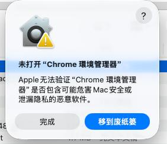

# Chrome 環境管理器 · 下載

用圖形介面管理多個互相隔離的 Chrome 環境，一鍵開啟；可同時登入同一個網站的多個帳號，代理可選。

## 下載

**最新版 0.1.22：[下載 ChromeEnvManager-0.1.22-macos.zip](https://github.com/rockyhua319/chrome-env-manager/raw/main/ChromeEnvManager-0.1.22-macos.zip)**（macOS 13 以上，Intel 與 Apple Silicon 通用）

需要先安裝 [Google Chrome](https://www.google.com/chrome/)。

<details>
<summary>全部版本</summary>

| 版本 | 檔案 | 說明 |
| --- | --- | --- |
| 0.1.22 | [ChromeEnvManager-0.1.22-macos.zip](https://github.com/rockyhua319/chrome-env-manager/raw/main/ChromeEnvManager-0.1.22-macos.zip) | macOS 13 以上，Intel 與 Apple Silicon 通用 |
| 0.1.21 | [ChromeEnvManager-0.1.21-macos.zip](https://github.com/rockyhua319/chrome-env-manager/raw/main/ChromeEnvManager-0.1.21-macos.zip) | macOS 13 以上，Intel 與 Apple Silicon 通用 |
| 0.1.20 | [ChromeEnvManager-0.1.20-macos.zip](https://github.com/rockyhua319/chrome-env-manager/raw/main/ChromeEnvManager-0.1.20-macos.zip) | macOS 13 以上，Intel 與 Apple Silicon 通用 |
| 0.1.18 | [ChromeEnvManager-0.1.18-macos.zip](https://github.com/rockyhua319/chrome-env-manager/raw/main/ChromeEnvManager-0.1.18-macos.zip) | macOS 13 以上，Intel 與 Apple Silicon 通用 |
| 0.1.17 | [ChromeEnvManager-0.1.17-macos.zip](https://github.com/rockyhua319/chrome-env-manager/raw/main/ChromeEnvManager-0.1.17-macos.zip) | macOS 13 以上，Intel 與 Apple Silicon 通用 |
| 0.1.16 | [ChromeEnvManager-0.1.16-macos.zip](https://github.com/rockyhua319/chrome-env-manager/raw/main/ChromeEnvManager-0.1.16-macos.zip) | macOS 13 以上，Intel 與 Apple Silicon 通用 |
| 0.1.15 | [ChromeEnvManager-0.1.15-macos.zip](https://github.com/rockyhua319/chrome-env-manager/raw/main/ChromeEnvManager-0.1.15-macos.zip) | macOS 13 以上，Intel 與 Apple Silicon 通用 |
| 0.1.14 | [ChromeEnvManager-0.1.14-macos.zip](https://github.com/rockyhua319/chrome-env-manager/raw/main/ChromeEnvManager-0.1.14-macos.zip) | macOS 13 以上，Intel 與 Apple Silicon 通用 |
| 0.1.13 | [ChromeEnvManager-0.1.13-macos.zip](https://github.com/rockyhua319/chrome-env-manager/raw/main/ChromeEnvManager-0.1.13-macos.zip) | macOS 13 以上，Intel 與 Apple Silicon 通用 |
| 0.1.12 | [ChromeEnvManager-0.1.12-macos.zip](https://github.com/rockyhua319/chrome-env-manager/raw/main/ChromeEnvManager-0.1.12-macos.zip) | macOS 13 以上，Intel 與 Apple Silicon 通用 |
| 0.1.11 | [ChromeEnvManager-0.1.11-macos.zip](https://github.com/rockyhua319/chrome-env-manager/raw/main/ChromeEnvManager-0.1.11-macos.zip) | macOS 13 以上，Intel 與 Apple Silicon 通用 |
| 0.1.10 | [ChromeEnvManager-0.1.10-macos.zip](https://github.com/rockyhua319/chrome-env-manager/raw/main/ChromeEnvManager-0.1.10-macos.zip) | macOS 13 以上，Intel 與 Apple Silicon 通用 |
| 0.1.9 | [ChromeEnvManager-0.1.9-macos.zip](https://github.com/rockyhua319/chrome-env-manager/raw/main/ChromeEnvManager-0.1.9-macos.zip) | macOS 13 以上，Intel 與 Apple Silicon 通用 |
| 0.1.8 | [ChromeEnvManager-0.1.8-macos.zip](https://github.com/rockyhua319/chrome-env-manager/raw/main/ChromeEnvManager-0.1.8-macos.zip) | macOS 13 以上，Intel 與 Apple Silicon 通用 |
| 0.1.7 | [ChromeEnvManager-0.1.7-macos.zip](https://github.com/rockyhua319/chrome-env-manager/raw/main/ChromeEnvManager-0.1.7-macos.zip) | macOS 13 以上，Intel 與 Apple Silicon 通用 |
| 0.1.6 | [ChromeEnvManager-0.1.6-macos.zip](https://github.com/rockyhua319/chrome-env-manager/raw/main/ChromeEnvManager-0.1.6-macos.zip) | macOS 13 以上，Intel 與 Apple Silicon 通用 |
| 0.1.5 | [ChromeEnvManager-0.1.5-macos.zip](https://github.com/rockyhua319/chrome-env-manager/raw/main/ChromeEnvManager-0.1.5-macos.zip) | macOS 13 以上，Intel 與 Apple Silicon 通用 |
| 0.1.4 | [ChromeEnvManager-0.1.4-macos.zip](https://github.com/rockyhua319/chrome-env-manager/raw/main/ChromeEnvManager-0.1.4-macos.zip) | macOS 13 以上，Intel 與 Apple Silicon 通用 |
| 0.1.3 | [ChromeEnvManager-0.1.3-macos.zip](https://github.com/rockyhua319/chrome-env-manager/raw/main/ChromeEnvManager-0.1.3-macos.zip) | macOS 13 以上，Intel 與 Apple Silicon 通用 |
| 0.1.2 | [ChromeEnvManager-0.1.2-macos.zip](https://github.com/rockyhua319/chrome-env-manager/raw/main/ChromeEnvManager-0.1.2-macos.zip) | macOS 13 以上，Intel 與 Apple Silicon 通用 |
| 0.1.1 | [ChromeEnvManager-0.1.1-macos.zip](https://github.com/rockyhua319/chrome-env-manager/raw/main/ChromeEnvManager-0.1.1-macos.zip) | macOS 13 以上，Intel 與 Apple Silicon 通用 |
| 0.1.0 | [ChromeEnvManager-0.1.0-macos.zip](https://github.com/rockyhua319/chrome-env-manager/raw/main/ChromeEnvManager-0.1.0-macos.zip) | macOS 13 以上，Intel 與 Apple Silicon 通用 |

</details>

## 安裝

1. 下載 zip，雙擊解壓，得到「Chrome 環境管理器」。
2. 把它拖進「應用程式」資料夾。
3. 第一次打開會被 macOS 擋下來，畫面寫著「未打開」、「Apple 無法驗證」。這是正常的，照下一節做一次就好，之後都正常。
4. 之後從 Launchpad、Spotlight 或「應用程式」資料夾打開即可。

## 打不開？看到「未打開」或「Apple 無法驗證」



這個應用沒有向 Apple 付費公證，macOS 對所有這類應用都會跳出這個視窗，不代表檔案有問題。解除一次之後，以後打開、以及在程式裡按「立即更新」都不會再問。

**先別按「丟到垃圾桶」（簡體介面叫「移到废纸篓」）。**

### macOS 15 或更新（Sequoia、Tahoe）

1. 雙擊打開一次，看到「未打開」的視窗後按「完成」。一定要先試開一次，下一步的按鈕才會出現。
2. 打開「系統設定」，左邊選「隱私權與安全性」（簡體：隐私与安全性）。
3. 往下捲到「安全性」，會看到「已阻擋『Chrome 環境管理器』以保護你的 Mac」，按旁邊的「強制打開」（簡體：仍要打开）。
4. 跳出「要打開『Chrome 環境管理器』嗎？」，再按一次「強制打開」，然後用 Touch ID 或輸入 Mac 的登入密碼。
5. 程式打開了，以後直接雙擊即可。

### macOS 13 / 14（Ventura、Sonoma）

在「應用程式」裡對「Chrome 環境管理器」按右鍵（或按住 Control 點一下）→「打開」→ 再按一次「打開」。

### 常見狀況

- **不小心按了「丟到垃圾桶」**：打開 Dock 上的垃圾桶，對「Chrome 環境管理器」按右鍵 →「放回原位」（簡體：放回原处），再從上面第 1 步做起；或者重新下載一次。
- **「系統設定」裡找不到「強制打開」**：表示還沒試著打開過，或試開之後隔太久了。回去雙擊一次程式，按「完成」，馬上再到「系統設定」看。
- **會用「終端機」的話**：把下面這行貼進「終端機」按 Enter，就不用進系統設定，之後直接雙擊打開：

  ```
  xattr -dr com.apple.quarantine "/Applications/Chrome 環境管理器.app"
  ```

## 第一次使用

1. 應用會自動找到 Chrome。
2. 輸入要建立幾個環境，按「建立」。
3. 每張卡片點一下就會開出一個獨立的 Chrome 視窗，第一個分頁是這個環境的資訊頁（名稱、目前的出口 IP 和地區、常用網站連不連得上）；分頁標題和網址列左邊都會顯示環境名稱。各環境的登入狀態互不相通。
4. 需要代理時，到「代理」頁把代理放進代理庫（貼上或連接代理平台），再分配給環境；不用代理也可以直接使用。

資料存放位置：`~/Library/Application Support/ChromeEnvManager/`
